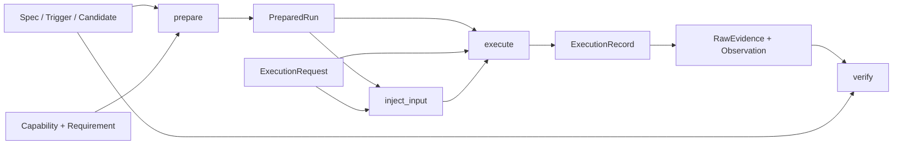

# M0-A：领域契约与内存 Mock

基线为 `ed5a90892fe63e1fd7e2044a05094c56a2191479`。M0-A 建立可序列化的领域对象、平台能力协商、适配器协议和 CPU 内存 Mock；本阶段没有运行候选程序、真实漏洞、模型 API、GPU 或 MCU，也没有重跑 Preflight-01C CUDA 实验。原有 GPU 证据继续受原验收报告的范围约束。

## 数据流与模块

`core.py` 提供事实、严格模型和科学内容身份；`domain.py` 提供研究对象及证据关系；`platforms.py` 提供多维能力和保守协商；`protocol.py` 描述适配器流程；`mock.py` 实现无外部执行的确定性模拟。



模型记录声明及关系；它们不运行编译器、调试器或候选文本。一个 `PoCCandidate.payload` 可以只是非可执行的合同样例文本。

| 对象 | 关键字段与关系 |
| --- | --- |
| `Fact[T]` | `value`、`status`、`source`、字符串 `provenance`。默认是 `UNKNOWN` / `value=null`。 |
| `VulnerabilitySpec` | `name`、`affected_component`、`source_trust`、`platform_id`、`description`、`provenance`，可选 `source_sha256`。 |
| `TriggerConstraint` / `TriggerSpec` | 条件名、表达式和 `knowledge: Fact[bool]`；触发规格关联漏洞、平台和唯一条件 ID。表达式不被求值。 |
| `PoCCandidate` | 关联漏洞、触发规格、平台；保存 `language`、`description`、`expected_behavior`、`platform_requirement`、`payload` 和来源。源码 SHA-256 根据实际 UTF-8 payload 计算。 |
| `ExecutionBudget` | 正数 `timeout_seconds`、`max_memory_bytes`、`max_output_bytes`，及非负 `max_input_bytes`。时间必须用显式 `float`。 |
| `ExecutionRequest` | 独立 `run_id`，以及候选、平台、预算、`intent`、`verification_requirement`；具有自动科学 `id`。 |
| `Provenance` | 来源、方法、科学平台 `scope`，以及可选源码哈希、运行 ID、位置、时间和模型置信度。这里的 `scope` 是平台 ID，区别于执行范围枚举。 |
| `InputEvent` | `run_id`、自由配置接口标识 `name`、原始 `data: bytes`。名称精确匹配，大小写不转换。 |
| `EvidenceReference` / `RawEvidence` | 引用绑定运行、候选、平台、类型、SHA-256、字节长度和来源；原始对象保存实际 `content: bytes` 并校验长度、哈希。 |
| `Observation` | 绑定运行、候选、平台和来源；保存种类、事实状态、是否满足，以及条件 ID 和原始证据 ID。条件或 sanitizer 观察必须指定条件。 |
| `ExecutionRecord` | 记录来源、执行范围、完成状态、终止类型和退出码。`NOT_EXECUTED` 不能宣称完成或退出码。 |
| `VerificationResult` | 保存候选、触发规格、执行记录、原始证据、观察、结论、理由、执行范围，以及派生解释 `unmet_conditions`（当前触发规格的未满足条件 ID）和 `limitations`（结论限制），校验整个引用关系。 |

`SourceTrust` 的 `UNKNOWN / UNREVIEWED / REVIEWED` 是来源审查声明，不会自动授予运行真实漏洞的权限。`SourceKind` 区分模型、静态分析、文档、用户需求、合成样例、Mock、真实执行和模拟器等来源。

## 严格构造、JSON 与版本

所有数据模型使用 `schema_version="1.0"`。模型冻结、拒绝额外字段、重校验嵌套实例，并禁止可变容器及 NaN/Infinity。Python 构造使用枚举实例、`tuple` 和 `bytes`；不把字符串枚举、列表、整数时间或字符串字节静默转换为预期类型。

事实为 `OBSERVED / INFERRED` 时必须有值、明确来源和 provenance；`UNKNOWN / NOT_CHECKED / UNSUPPORTED` 的值必须为 `null`，不能默填 `false` 或 `0`。模型来源不能标记为 `OBSERVED`。

传输 JSON 使用 `model_validate_json(...)`；`to_json()` 输出规范化 JSON。元组在 JSON 中表示数组，枚举表示其字符串值，字节采用 URL-safe base64 编码，可以无损保存 `0x00`、`0xff` 和二进制总线数据。不能把 `model_dump(mode="json")` 的结果直接当作严格 Python 构造参数：应通过 JSON 验证路径恢复类型。对象键按名称排序，数组顺序保留。

完整可复现样例由 [generate_json.py](../examples/m0a/generate_json.py) 生成：

- [m0a-mock-flow.json](examples/m0a-mock-flow.json)：规格、条件、候选、请求、Mock 执行和实际 Mock 原始字节证据的完整流程。
- [m0a-c8000-capability.json](examples/m0a-c8000-capability.json)：多维需求/能力合同及未知事实。

这些 JSON 是合成或 Mock 合同样例，不是设备测量报告。

## 科学内容 ID 与运行身份

`IdentityModel` 生成 `<prefix>:<sha256>`；提供的 `id` 必须与规范化科学内容一致。平台能力继承该模型，`label` 是人类描述，但仍属于序列化科学内容，改变标签也会改变能力 ID；`PlatformCapability.id` 才是候选、来源 `scope`、请求和证据使用的科学平台身份，引用不能使用标签代替。驱动/runtime 或其他维度变化会改变平台 ID，即使标签和 GPU/ISA 名称相同。

默认 `stable_id` 递归排除这些字段：`id`、`run_id`、`locator`、`host_path`、`hostpath`、`timestamp`、`created_at`、`updated_at`、`recorded_at`、`observed_at`、`collected_at`、`started_at`、`ended_at`、`model_confidence`。排除只针对结构字段名，不会删除 payload 内的文本，也不等于隐私脱敏。候选/平台引用、实际源内容哈希、条件、预算和执行意图仍参与科学身份。`VerificationResult.identity_payload` 还显式排除派生解释 `unmet_conditions` 和 `limitations`；这两个展示字段不改变底层科学结论 ID。

`run_id` 独立标识一次执行。相同科学请求可以有不同 `run_id`；相同证据内容可以有相同科学 ID，但不能跨运行直接复用引用。`PreparedRun.content_id` 根据候选、完整能力、有效需求和预算生成；`preparation_id` 是该适配器登记的独立 UUID 实例，不进入这个内容 ID。运行时仍检查完整请求及准备实例，不能用内容 ID 替代运行归属检查。

## 多维平台与保守协商

能力和需求分别表达 `category`、`isa`、`isa_profile`、`os`、`binary_format`、`endian`、`bit_width`、`abi`、`toolchain`、`runtime`、`execution_mode`，以及调试、观察、输入、原始证据能力。每个能力维度是带状态和来源的 `Fact`；接口能力是标识符元组，核心不解释或硬编码 backend 名称。

`execution_mode` 分开表示 `REAL_HARDWARE / SIMULATOR / MOCK`。模拟器或 Mock 不能满足真实硬件要求。OS 可以描述裸机或 RTOS；JTAG 标识不自动等于 GDB，UART/CAN/SPI/GPIO 也不自动提供调试或观察能力。

需求字段 `None` 表示未施加该约束；显式 `Fact(status=UNKNOWN)` 是未知要求，不是通配符。标量维度必须精确匹配，接口维度要求子集匹配。未知或未检测的必需事实返回 `UNKNOWN`；明确不支持或不匹配返回 `UNSUPPORTED`。同时存在明确不匹配和未知项时，结论为 `UNSUPPORTED`，逐维问题仍保留。两者均不能进入可执行准备状态。`MockAdapter.prepare` 同时协商候选自带需求、调用者需求及准备所依赖的关键维度，不会绕过未知依赖。

C8000 样例仅表达需求合同：non-GDB JTAG 调试、UART/CAN/SPI/GPIO 输入、UART 观察和带来源的目标/工具链声明。`isa_profile`、`endian`、`bit_width`、`abi` 保持 `UNKNOWN` 或 `NOT_CHECKED`，不按型号补值。需要工具链版本但尚未知时，同样必须保留未知事实。样例中的 manual/source 标识描述合同来源，不表示本阶段读过或核验过厂商手册，更不表示接入或验证过真实 C8000。生成该 JSON 的流程只调用 `negotiate`，记录 `UNKNOWN / can_execute=false`，未调用真实 backend 准备或执行；Mock 对未知准备依赖的拒绝另由 CPU 合同测试检验。

## 适配器流程与 Mock 边界

1. `query_capability()` 返回科学平台能力；`negotiate(requirement)` 给出兼容状态和逐维问题。
2. `prepare(candidate, requirement, budget)` 返回 `READY / REJECTED / FAILED / UNKNOWN`。只有 `READY` 有 `PreparedRun`，兼容决定与准备对象必须绑定同一科学平台。
3. 构造绑定候选、平台、预算和 `run_id` 的请求。`PREPARE` 意图不能注入或执行运行；`RUN / PREPARE_AND_RUN` 可以进入 Mock 执行流程。
4. 在执行前调用 `inject_input(prepared, request, event)`。已接受输入有 `INPUT` 类型原始字节证据；不支持的接口返回显式拒绝，身份或预算错误抛出 `AdapterContractError`。
5. `execute(prepared, request)` 产生 `ExecutionRecord`；每个运行实例只执行一次，执行后拒绝输入。替换准备对象、平台、候选、预算或请求语义都会被拒绝。
6. `collect_raw_evidence(execution)` 重校验实际字节哈希、来源和运行归属；`verify(candidate, trigger, execution)` 产生受限结论。

Mock 不调用 subprocess、网络、文件、编译器、模型 API 或真实硬件，也不解释候选文本。其原始字节明确包含 Mock 描述；来源和执行范围始终是 `MOCK`。`NORMAL`、`PREPARATION_FAILED`、`EXECUTION_FAILED`、`UNKNOWN` 提供确定性正常和失败路径。原始输出不包含运行 ID 或准备 UUID，因此相同科学配置的字节哈希可重复。

预算约束的是逻辑 payload、输入和模拟输出字节及固定模拟步骤，不是 Python 进程 RSS、操作系统沙箱或真实设备资源限权。`max_output_bytes` 限制模拟执行输出；输入收据由累计 `max_input_bytes` 单独约束，候选、输入及输出字节共同计入逻辑内存预算。本 Mock 明确拒绝空输入事件，因此每份有效输入收据至少消耗一个输入字节，有限输入预算也限制收据数量；协议本身不禁止未来适配器实现空事件。长期服务的实例寿命及跨运行总量仍需未来执行器策略。

绑定请求的 `verification_requirement=NONE` 时，显式 `verify` 返回 `NOT_CHECKED`，保留证据及关系校验，并说明未进行条件验证。`CONDITION_LINKED_RUNTIME` 才调用条件评估；Mock 的结论只能是 `NOT_VERIFIED` 或 `UNKNOWN`，不能成为真实漏洞 `VERIFIED`。

## 证据与结论的科学边界

源码 SHA-256 关联实际候选文本；原始证据 SHA-256 和长度关联实际字节。证据及观察必须属于同一候选、科学平台和运行，引用的条件/原始证据必须存在，来源声明及哈希关系不得冲突。缺少或未知的触发条件传播为 `UNKNOWN`，不能用模型置信度、编译成功、普通退出、崩溃或超时替代目标条件证据。

当前 `VERIFIED` 结构规则要求客观来源及匹配执行范围、正常完成的执行、每个已建立条件的 `OBSERVED / satisfied=True` 观察，以及候选哈希一致的关联 runtime 原始证据。结论不能超出记录的执行范围。

这些规则只检查结构和内容关系，不能认证 producer 是否真的运行过硬件，哈希也不是设备签名。单元测试中带 fictional `REAL_EXECUTION` 声明的 `VERIFIED` 正向 fixture 仅检验合同规则，不构成 GPU/MCU 测试或漏洞证明。未来真实适配器仍需授权、隔离、限权和可信采集链。

## 本地复现

在仓库根目录使用 Python 3.10 或更新版本和项目虚拟环境：

```sh
python3 -m venv .venv
.venv/bin/python -m pip install setuptools==80.9.0 wheel==0.45.1
.venv/bin/python -m pip install --no-build-isolation --editable '.[dev]'
.venv/bin/python examples/m0a/generate_json.py
.venv/bin/python -m pytest
.venv/bin/python -m ruff check src tests examples/m0a
.venv/bin/python -m ruff format --check src tests examples/m0a
.venv/bin/python -m mypy src/heteropoclab
.venv/bin/python -m build --no-isolation --outdir output/m0a/dist
```

已有经审查的本地 wheelhouse 时，安装命令可追加 `--no-index --find-links output/m0a/wheelhouse`；该目录是本地依赖准备结果，仓库不会自动下载远程执行脚本。上述测试和示例均为 CPU 合同验证。测试数量、构建结果和 CI 状态以实际运行日志及 PR Checks 为准，本文不预设数量或远程 CI 成功结论。
